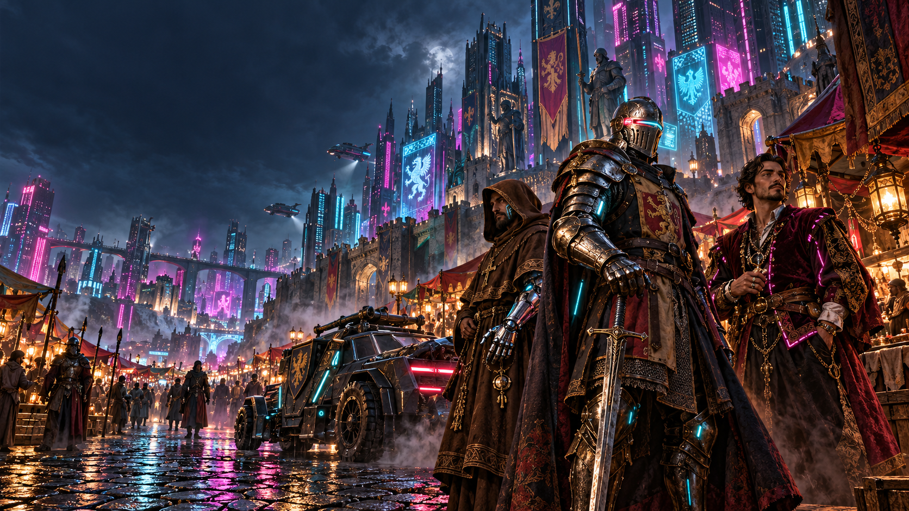
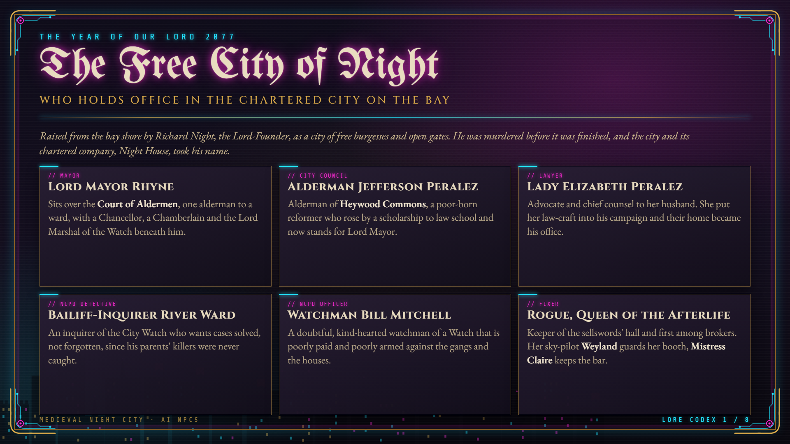
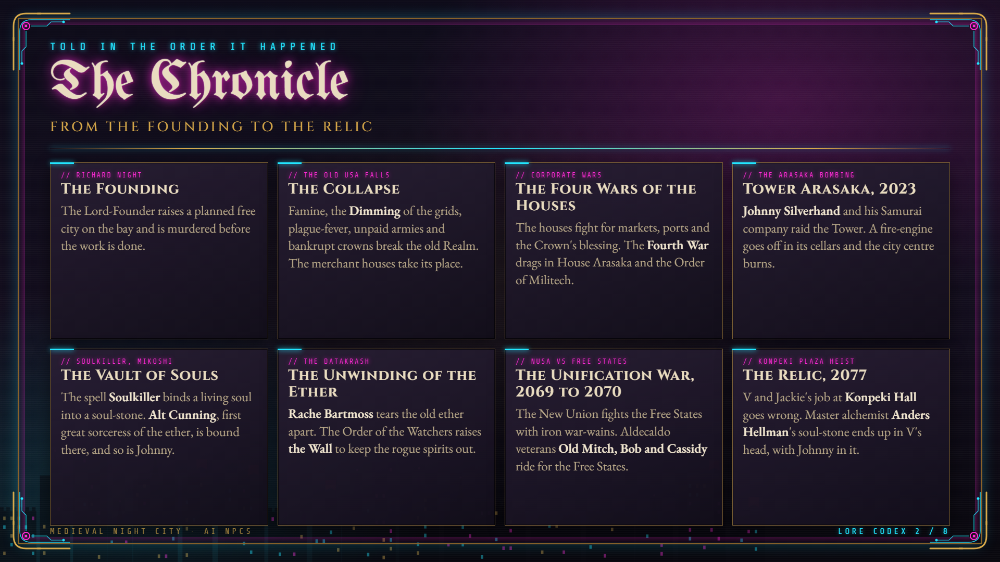
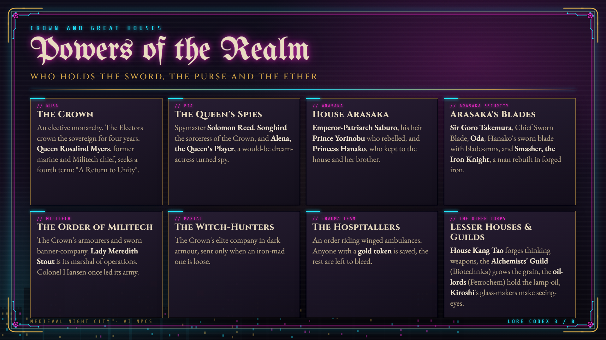
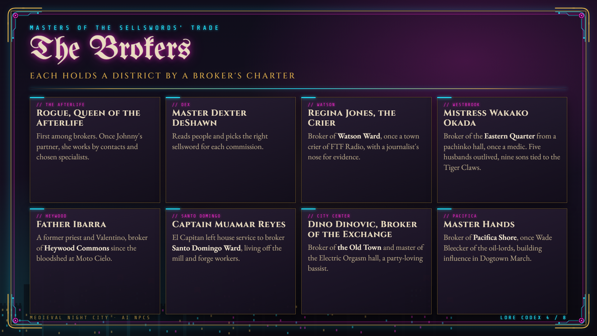
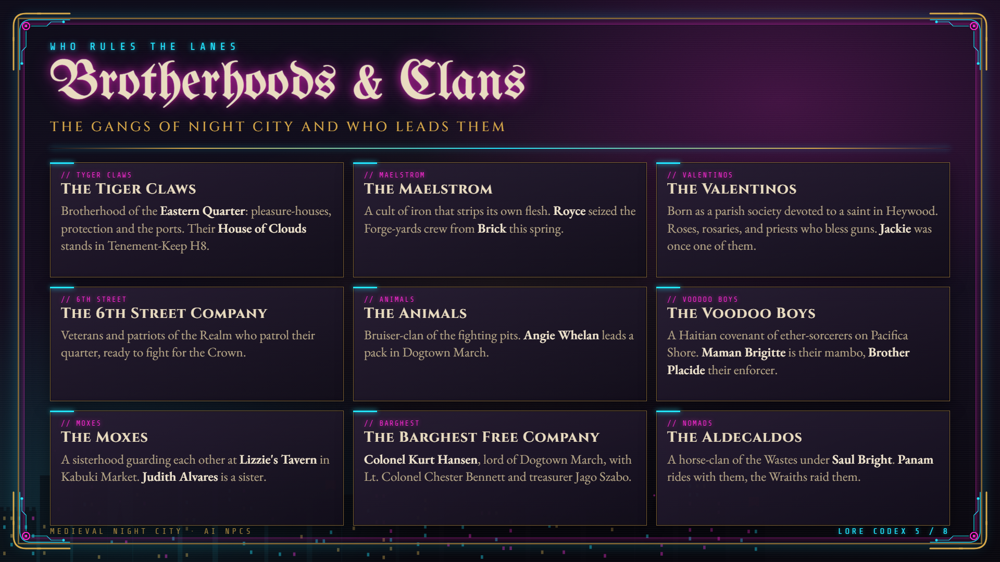
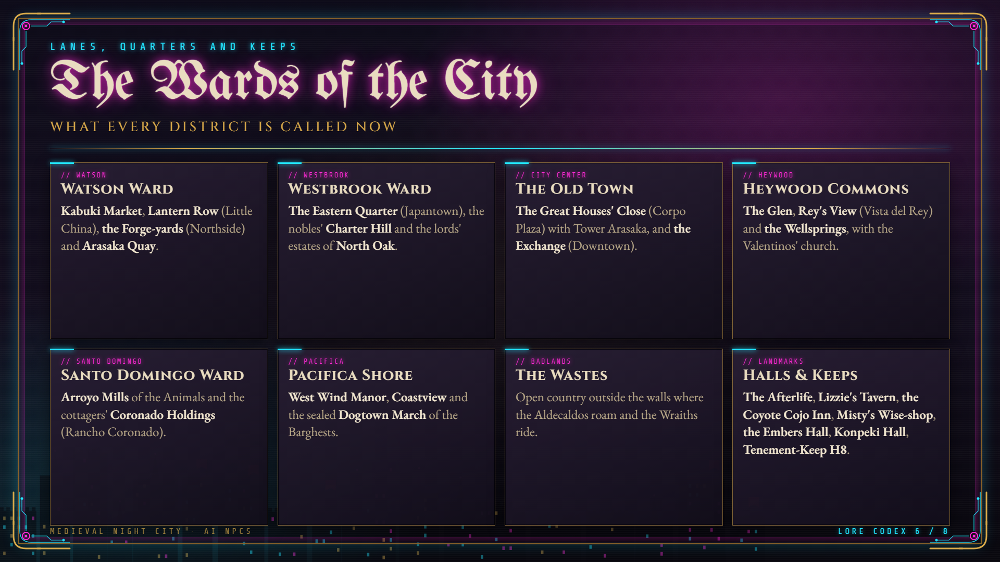
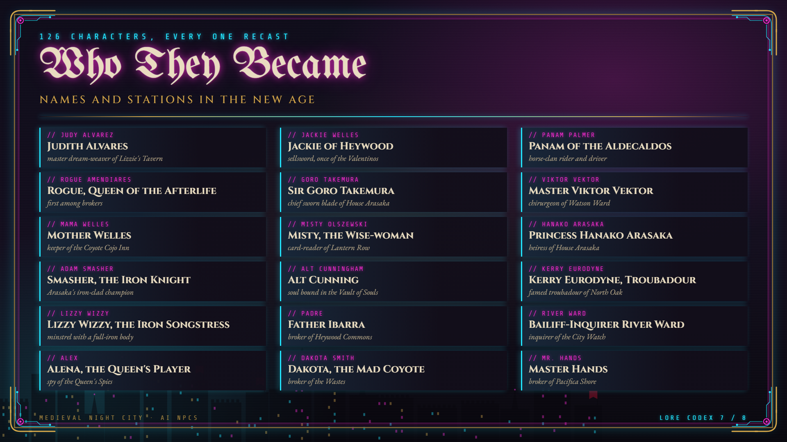
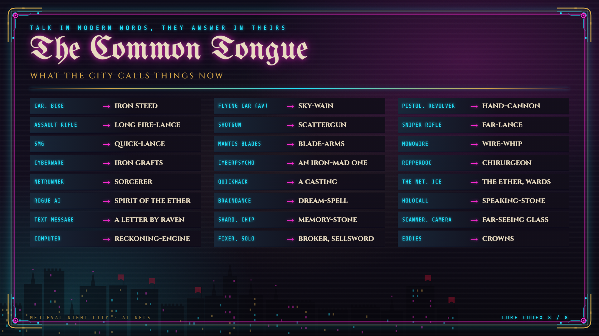

# Medieval Night City - AI NPCs

**Night City, but medieval.** Every character you talk to becomes a person of that age: knights, lords, sellswords, monks, bards, merchants and princesses, with new names, new stories and the speech to match.

A content pack for [AI NPC Cyberpunk Mod](https://github.com/alystria-ai/ai-npc-cyberpunk-mod) 0.3.2 or newer. Download it from [Nexus Mods](https://www.nexusmods.com/cyberpunk2077/mods/35950).

## A world written for it

Behind the pack is a custom lore bible of about 5,000 words ([LORE.md](LORE.md)) that rebuilds Night City's whole history and society as a medieval world, and every character was rewritten from it.

- **The history, retold in order.** The Collapse is the fall of the old Realm, the Corporate Wars are the Four Wars of the Houses, the Arasaka Tower blast is a fire-engine set off in the Tower's cellars, Soulkiller is a spell that binds souls into soul-stones, and the DataKrash is the Unwinding of the Ether that let the rogue spirits loose.
- **The powers of the realm.** The New Union is a kingdom with an elected Queen, Night City a chartered free city under a Lord Mayor and a Court of Aldermen, the Watch has constables, bailiffs and reeves, and the great houses have lords, stewards and men-at-arms.
- **Every trade and order.** Fixers are brokers of contracts who hold their districts by charter, solos are sellswords, netrunners are sorcerers of the ether, ripperdocs are barber-surgeons, braindance editors are dream-weavers, and every gang is a brotherhood or clan.
- **Places, money and daily life.** A fixed map of medieval names for the districts and landmarks, crowns for eddies, the faiths, the markets and how people live.
- **How people speak.** Registers for lords, sellswords, clergy and street folk, so a noble and a ganger never sound alike.
- **Nothing of the story is lost.** Each character keeps their facts, family, loyalties and looks, told through the new age.

## The lore codex

| | |
|---|---|
|  |  |
|  |  |
|  |  |
|  |  |

## What you get

- **A whole world recast.** Night City is a medieval free city. The corporations are great houses, Arasaka an imperial house from across the sea, the NCPD is the Watch, MaxTac the Witch-Hunters, Trauma Team the Hospitallers, netrunners are sorcerers of the ether and the Blackwall is the Wall that keeps the rogue spirits out. Cars are iron steeds, guns are fire-lances, eddies are crowns.
- **Every character rewritten.** All 126 story characters and all 80 kinds of ordinary townsfolk (gangers, vendors, guards, bartenders, fixers and more) have a new medieval bio, speaking style and sample lines.
- **New names.** Judith Alvares, Jackie of Heywood, Rogue, Queen of the Afterlife, Sir Goro Takemura, Master Viktor Vektor and many more. Passers-by get period names too. The old names still work when you talk, type or search.
- **They understand you.** Talk to them in plain modern words and they answer in theirs. Ask for a lift to Kabuki and you get an offer of an iron steed to Kabuki Market.
- **Works on every conversation provider.** On Mistral, Local AI and Custom every part of the pack applies. On Convai every character has its own medieval Convai character, with the new bio, name and memory.
- **Its own memory.** Talks with the medieval characters are kept apart from your normal ones.
- **Mature content too.** With the main mod's Mature content setting on, the crude talk turns into period oaths and bawdy words.
- **Voices stay the game's actors.** Only the words change.
- **One file for both game versions**, 2.5 and 2.31.

## Where it is going

For now only the words change. The goal is a true cross between a medieval and a cyberpunk world, where the neon and chrome stay but castles, banners and steel stand among them. Later updates are planned to replace the game's assets toward that look:

- **The world.** Buildings, signs, billboards, street props and shop fronts reworked so towers carry banners, markets look like fairs and the districts read as wards of a walled city.
- **Characters.** Altered character models, hair and faces, so knights, monks and merchants look the part next to the chrome.
- **Clothes.** Tabards, cloaks, robes, gambesons and armour mixed with cyberware and street wear.
- **Weapons.** Swords, axes, crossbows and fire-lances made to look like a blend of forged steel and smart tech.
- **Vehicles.** Cars and bikes reworked toward iron steeds and war-wains.
- **Music and sound.** Radio stations and ambient music replaced with period and medieval-fusion tracks.

## Make your own pack

This pack is also an example for anyone who wants to tune the prompting of the base mod. It has no code, only a settings file and text: world rules, prompt wording, bios, speaking styles, names and name pools for passers-by. The files are in [`bin/x64/plugins/cyber_engine_tweaks/mods/AiNpcCyberpunkModMedieval`](bin/x64/plugins/cyber_engine_tweaks/mods/AiNpcCyberpunkModMedieval):

- `convai-addon.json`: the pack's settings, world rules and prompt wording.
- `characters.json`: every character's medieval name, bio and speaking style.
- `npc-name-pools.json`: period names for passers-by.

See how each part changes the characters, and use it as a starting point for a pack of your own.

## Install

1. Install or update [AI NPC Cyberpunk Mod](https://www.nexusmods.com/cyberpunk2077/mods/35436) to 0.3.2 or newer.
2. Download the zip from [Nexus Mods](https://www.nexusmods.com/cyberpunk2077/mods/35950) and extract it into your Cyberpunk 2077 folder (the one with bin, archive and r6). It is one folder: `bin\x64\plugins\cyber_engine_tweaks\mods\AiNpcCyberpunkModMedieval`.
3. Start the game. Open Companion Manager > Settings > Content packs and check that Medieval AI NPCs is On. The new names show after the game has started once with the pack.

To turn it off, switch Medieval AI NPCs to Off in Settings > Content packs and press Apply. To remove it, delete the folder.

## License

See [LICENSE](LICENSE).
